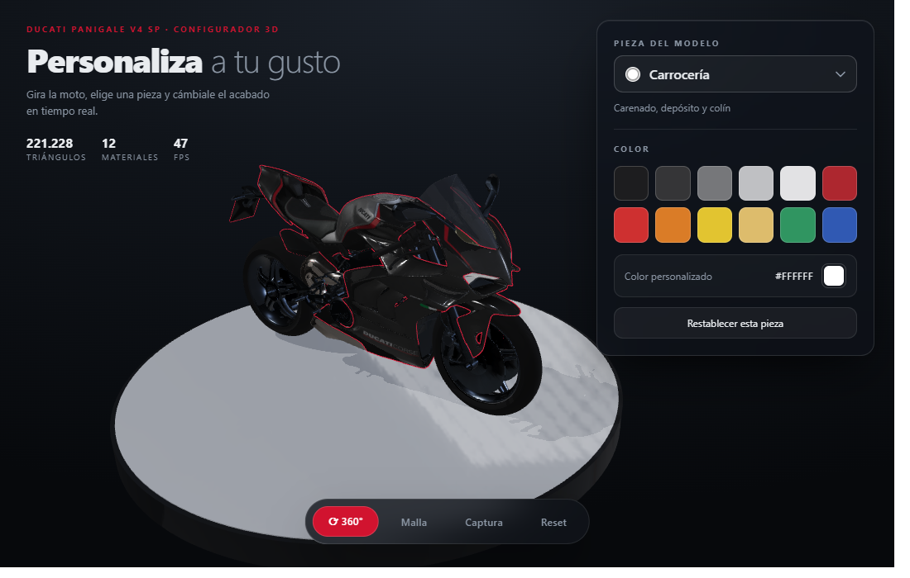
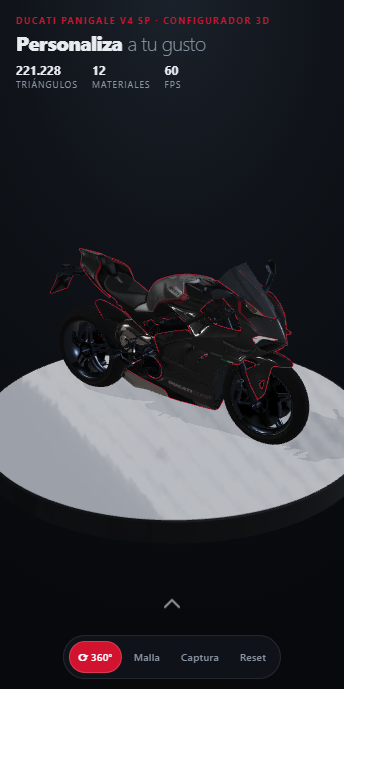

# Muestra Visor Motos

Visor y configurador 3D de una **Ducati Panigale V4 SP** para web. La moto gira en
360°, se elige una pieza y se le cambia el acabado en tiempo real. Incluye también las
fotos de referencia y los scripts con los que se modeló la moto en Blender y se exportó
a glTF.





## Arrancar

Requiere Node 18+.

```bash
npm install      # crea node_modules aquí (ignorado por git)
npm run dev      # http://localhost:5173
```

```bash
npm run build    # genera dist/ listo para publicar
npm run preview  # sirve dist/ para comprobarlo
```

## Qué hace

- **Órbita 360°** con inercia, auto-rotación, zoom y límites de cámara. El encuadre se
  calcula solo a partir del tamaño del modelo y del espacio libre que deja la interfaz.
- **12 piezas configurables**: carrocería, rines, chasis/motor, espejos, frenos,
  escape, asiento, cúpula, gomas, cadena, tablero y faro.
- **12 acabados + color personalizado** por pieza, con muestra del color actual.
- **Clic sobre el modelo** selecciona esa pieza y la marca con un contorno.
- **Modo malla**, **captura PNG**, y reset total o por pieza.
- **Responsive**: en móvil el panel se convierte en una hoja inferior plegable que
  sólo deja ver un chevrón flotante sobre la escena.

## Stack

- **Babylon.js 8** para el render PBR, la cámara orbital, las sombras y el IBL.
- **Vite 7** como bundler y servidor de desarrollo.
- **glTF 2.0** (`.glb`) con texturas WebP embebidas: un único archivo de ~8 MB.

## Estructura

```
.
├── index.html                 # dashboard: canvas + HUD
├── public/assets/
│   ├── panigale_web.glb       # modelo (8 MB, texturas WebP embebidas)
│   └── studio_env.jpg         # HDRI de estudio como JPEG equirectangular
├── src/
│   ├── main.js                # arranque: escena + registro de materiales
│   ├── viewer.js              # Babylon: cámara 360, luces, sombra, entorno, encuadre
│   ├── paint.js               # gestor de acabados (albedoColor + ganancias)
│   ├── config.js              # catálogo de piezas, presets y conversión de color
│   ├── ui.js                  # HUD: desplegable, paleta, hoja móvil, controles
│   └── style.css              # tema oscuro con paneles de cristal
└── blender/
    ├── README.md                   # pipeline de modelado y exportación
    ├── ref/                        # fotos de referencia usadas para medir la moto
    └── scripts/                    # vlib, texture_lib, pbr_setup, export_web_glb
```

`docs/` es el build ya compilado que se publica en GitHub Pages (se regenera con
`npm run build`). El archivo fuente `moto_v6_panigale_sp.blend` (49 MB) **no** está en
el repositorio, para no cargarlo con un binario que pesa más que todo lo demás junto. El
modelo final que consume la web es el `.glb` de `public/assets/`.

## Cómo se cambia el color

Cada pieza es un material del glTF. El color se aplica sobre `albedoColor` del
`PBRMaterial`, que en glTF equivale al `baseColorFactor` y **se multiplica** con la
textura de color. Así se conservan el grano de la pintura, los mapas de normales, las
rugosidades y los calcados de la librea (`DUCATI CORSE`, franjas rojas) — sólo cambia
el tono.

`gain` en [src/config.js](src/config.js) compensa que la textura sea más oscura o más
clara que 1: la carrocería se multiplica por 30 porque su textura es muy oscura,
mientras que las piezas metálicas usan ~2.5. `base` es el `baseColorFactor` de fábrica,
de modo que *Reset* devuelve exactamente la apariencia original.

## Detalles que costaron sangre

Están documentados porque son fáciles de repetir:

**El desplegable de piezas** no es un `<select>` nativo (no se puede estilizar ni mostrar
el color de cada pieza). Es una lista propia con tres trampas:

- El `backdrop-filter` del panel lo convierte en *containing block* de los
  `position: fixed`, así que el menú se cuelga del `body` y se posiciona con las
  coordenadas del botón.
- Nada de `scrollIntoView()`: mueve también el panel, dispara su evento `scroll` y el
  propio manejador cerraba el menú. El desplazamiento se hace sobre la lista.
- Mide el alto real del contenido y el espacio libre arriba/abajo para abrir hacia
  arriba cuando no cabe, recortando el `max-height` al hueco disponible.

**La hoja móvil** anima `height` con valores medidos en JS (`from` → `to` reales).
Animar `max-height` hacía que el tope visible se alcanzara en el primer tercio y el
recorrido se sintiera de golpe. El contenido nunca se quita del DOM: lo recorta la
altura, así que se descubre a medida que sube.

**El suelo** es una plataforma de dos cilindros (tapa de aluminio y canto grafitado).
Al principio compartían el plano superior y el abanico de triángulos de ambas tapas
producía *z-fighting* en forma de estrías radiales; la base quedó 5 mm por debajo.

## El modelo 3D

El visor usa un modelo real importado de Sketchfab y adaptado: se le montó un rig de 9
huesos (`root → body → steer → front_suspension → front_wheel`, `body → swingarm →
rear_wheel`, `body → shock`, `steer → handlebar`), se le asignaron materiales PBR CC0 y
se separaron los materiales por pieza para poder teñirlos.

En [blender/](blender/) están las fotos de referencia y los scripts: la biblioteca de
primitivas (`vlib.py`), el constructor de materiales PBR (`texture_lib.py`), el setup de
materiales (`pbr_setup.py`) y el exportador a web (`export_web_glb.py`). Ver
[blender/README.md](blender/README.md) para el detalle del pipeline y las trampas.

### Regenerar el GLB

El `.blend` no viaja en el repo, así que para reexportar necesitas la escena
`moto_v6_panigale_sp.blend` (rig, materiales y texturas empaquetadas) junto a esta
carpeta:

```bash
blender -b blender/moto_v6_panigale_sp.blend -P blender/scripts/export_web_glb.py
```

Escribe `public/assets/panigale_web.glb`. El script restaura los colores de fábrica,
puentea los nodos `Mix` de Base Color (el exportador de glTF los interpreta mal),
reduce las texturas, suelta las mallas del rig y exporta sin tangentes.

## Publicar en GitHub Pages

**GitHub Pages sirve archivos estáticos, no ejecuta un bundler.** Por eso el
`index.html` de la raíz (el fuente) no sirve publicado: apunta a `/src/main.js`, y el
navegador no sabe resolver los `import '@babylonjs/core'` sin pasar por Vite. Lo que se
publica es la carpeta `docs/`, que ya viene construida.

```bash
npm run build     # regenera docs/ (13,9 MB, rutas relativas)
```

1. Arrastra la carpeta completa al repositorio (incluye `docs/`).
2. **Settings → Pages → Source:** *Deploy from a branch* → Branch `main`, Folder
   **`/docs`** → Save.
3. Espera un minuto y abre `https://<usuario>.github.io/<repo>/`.

`docs/.nojekyll` evita que Jekyll procese el sitio, y como el build usa rutas relativas
(`base: './'`) funciona igual en la raíz del dominio que en un subpath como
`/propuesta-personalizaci-n-motos/`.

Si prefieres no versionar el build: borra `docs/` y añade una acción de GitHub que
ejecute `npm ci && npm run build` y publique el resultado.

### Contenido y peso

El repositorio son **22,5 MB**: 8,6 MB de fuente + 13,9 MB del build en `docs/` (que
duplica el `.glb`). Si arrancas el proyecto en local aparecerán `node_modules/`; está en
[.gitignore](.gitignore) para el flujo con `git`, pero la subida por arrastre no lee ese
archivo, así que bórralo antes de arrastrar (o usa `git push`).

## Créditos y licencias

- **Modelo 3D**: *2021 Ducati Panigale V4 SP* por **brainlesszombie5** en
  [Sketchfab](https://sketchfab.com), licencia **CC BY**. Requiere atribución.
- **Texturas PBR**: [ambientCG](https://ambientcg.com) y [Poly Haven](https://polyhaven.com), **CC0**.
- **HDRI**: `studio_small_09` de Poly Haven, **CC0**.

Las marcas, el diseño y la librea Ducati son propiedad de Ducati Motor Holding. Este
proyecto es una demostración técnica de visor/configurador 3D sin ánimo comercial.
